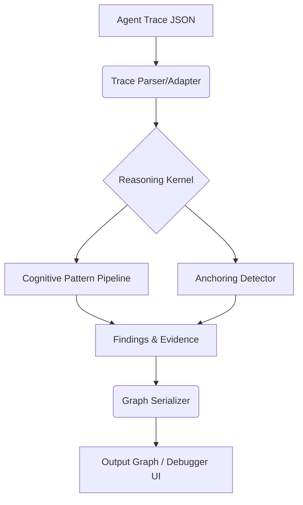

# Reasoning IR

A deterministic, domain-agnostic Reasoning Debugger for structured AI-agent traces.

## The Problem
AI agents execute tasks through sequential reasoning steps. When an early error occurs (e.g., an unsupported assumption), it corrupts all downstream decisions. Current evaluation tools focus entirely on the final output (the "what"), making it nearly impossible to debug the reasoning chain (the "why" and "where").

Reasoning IR isolates the exact moment reasoning breaks down—pinpointing the **root failure** and mapping its downstream consequences without relying on guesswork.

## Determinism & Scope
* **Strict Determinism:** The identical reasoning trace parsed by the same version of the Debugger will always produce the exact same findings.
* **Zero-LLM Execution:** The detection and propagation logic runs locally using deterministic structural analysis. No LLMs are used in the debugging process.
* **Evidence-Based:** The Debugger does not invent evidence. If information is missing from the trace, no unsupported finding is issued.
* **Representation, Not Intent:** The system does not claim to understand the internal "intent" of the AI agent. It strictly analyzes the structured representation provided to it.

## What This Is NOT
* **Not an LLM:** This is a structural analysis kernel, not a generative model.
* **Not a Prompt Engineering Framework:** It evaluates agent traces; it does not generate prompts.
* **Not an Agent Framework:** It does not execute actions, API calls, or web searches.

## Quick Start

### 1. Run the Product Demo
Run the provided demo to see the debugger isolate a root failure and trace its cascading impact:
`python demo_debugger.py`

### 2. Run the Test Suite
The current test suite passes successfully, enforcing the architectural contracts:
`PYTHONPATH="$PWD" python -m pytest -q`

## Documentation
Please refer to ARCHITECTURE.md for a deep dive into the separation of concerns, the reasoning graph, and the first-failure localization pipeline.

## Architecture (High-Level)

